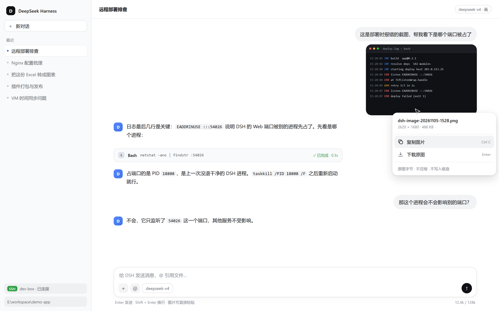
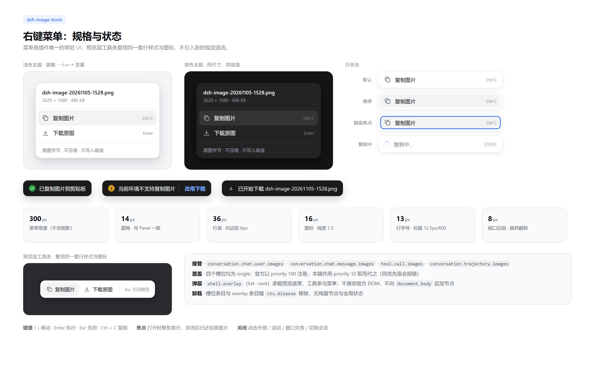
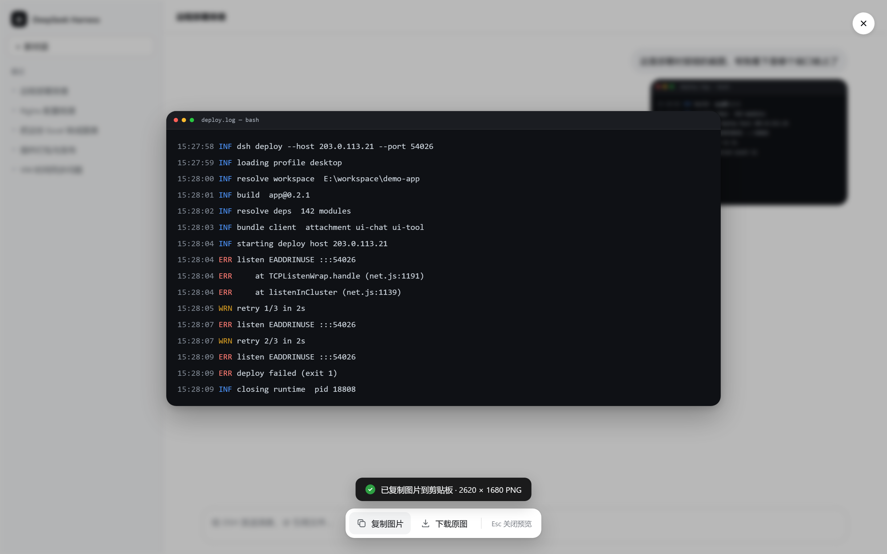

# dsh-image-tools · 设计方案

> 版本：v0.1 设计评审 · 2026-11-05
> 目标：解决"对话里发出去的图片只能看、不能复制/下载"
> 形态：DSH 插件（bundle + host 空壳 + browser half）
> 状态：**v0.1.0 已实现，隔离 profile 验收通过（2026-11-05）**



---

## 1. 问题与结论

对话里出现的图片（粘贴的截图、上传的图片、助手/工具渲染的图片）目前只有"缩略图 → 全屏预览"，预览层里只有图片和一个关闭按钮；桌面端右键菜单只在输入框或选中文字时构造，图片上右键没有任何反应。整场会话可以用「更多操作 → 下载 Session 日志」导出 ZIP（内含 `media/<attachmentId>.<ext>`），但没有单张图片的复制或下载。

数据没有丢：图片按内容寻址存在 `~/.dsh/attachments/v1/objects/<sha256>`，ZIP 导出也证明浏览器下载链路在桌面端可用。缺的是**单张图片的动作入口**。

本插件只做一件事：**给对话里的每一张图片补上「复制图片」和「下载原图」**。

## 2. 目标与非目标

### 目标

- 对话中的任意图片都能一键复制到剪贴板（无损、原分辨率）。
- 任意图片都能下载为原始字节、原始格式（jpg 仍是 jpg，不转码）。
- 视觉与交互贴合 DSH 现有语言；不改变消息布局；深色主题可用。
- 纯客户端实现，不联网、不落盘（下载交给浏览器）。
- 卸载即恢复官方表现。

### 非目标

- 非图片附件（PDF / Office / zip）的单条下载 —— 二期方案见 §9。
- Markdown 外链图片（http/https）—— 保留浏览器默认行为。
- 图片编辑、标注、缩放、批量导出。
- 复制"文件"或"路径"：图片是 blob URL，没有磁盘路径可复制。

## 3. 方案选择

### 采用：接管图片槽位 + `shell.overlay` 弹层

DSH 的图片由 `@deepseek-ai/dsh-client-ui-attachment` 注册到四个插槽，均为 `single`：

| 插槽 | 位置 |
|---|---|
| `conversation.chat.user.images` | 用户消息里的图片 |
| `conversation.chat.message.images` | 助手消息里的图片块 |
| `tool.call.images` | 工具结果里的图片 |
| `conversation.trajectory.images` | 轨迹视图的 48px 缩略图 |

官方以 `priority: 100` 注册；同优先级重复注册会报错，**更低的 priority 覆盖渲染**（渲染器明确"lowest renders"）。插件用 `priority: 10` 接管，渲染自己的缩略图组件；预览层与右键菜单注册进 `shell.overlay`（`list` / `root`，`z-index: 20`，子元素自动接收指针事件）。

这套做法只走官方扩展点：不查询官方 DOM、不向 `document.body` 追加节点、不 `require` 官方客户端包、不碰应用根节点。

### 否决：document 级右键监听 + body 追加菜单

代码更少、零视觉回归，但它要读取官方图片 DOM、向 `document.body` 追加浮层，违反 DSH 插件规范（`ui-plugin.md`：不要替换应用根、不要追加第二个应用、不要读别的插件 DOM 来估位置），且官方 DOM 结构一变就失效。不采用。

### 对照：上游官方做

最干净的是官方给图片加右键/预览动作。本插件不依赖它，等官方支持后可以直接下线。

### 代价（必须接受）

接管意味着复刻官方缩略图行为：单图 `single` 自适应尺寸、多图 64px 方图、轨迹 48px 缩略图、加载中/失败重试。这部分是本方案的主要回归风险，验证阶段要逐项对照官方截图。

## 4. 交互设计

### 4.1 入口

| 操作 | 结果 |
|---|---|
| 右键缩略图 / 预览大图 | 弹出图片菜单（定位到鼠标处） |
| 悬停 / Tab 聚焦缩略图 | 右上角浮出复制、下载两个小圆钮 |
| 左键缩略图 | 打开全屏预览（含工具条） |
| 预览中 `Esc` / 点遮罩 | 关闭预览，焦点回到原缩略图 |

### 4.2 右键菜单



- 结构：标题（下载文件名 + `宽 × 高 · 大小`）→ 分隔线 → `复制图片`（Ctrl C）/ `下载原图`（Enter）→ 分隔线 → 说明行（原图字节·不压缩·不写入磁盘）。
- 尺寸：宽 300、圆角 14、内边距 6、行高 36、图标 16、行字号 13、标题 12.5/600、元信息 11。
- 定位：左上角对齐鼠标，四边留 8px 夹取；下方空间不足时向上翻。
- 状态：默认 / 悬停 / 键盘焦点（2px 品牌色描边）/ 复制中（转圈 + 半透明，禁点）。
- 键盘：`↑ ↓` 移动，`Enter` 执行，`Ctrl+C` 复制，`Esc` 关闭。
- 关闭：点外部、滚动、窗口失焦、切换会话、动作完成。

### 4.3 预览层



- 遮罩沿用官方观感（`--dsw-alias-bg-mask-1` + 半透明），大图圆角 16、`max-width: min(100%, 1600px)`、`object-fit: contain`。
- 右下/顶部保留官方关闭按钮位置习惯；插件工具条固定在底部居中：`复制图片` / `下载原图` / 分隔线 / `Esc 关闭预览`。
- 大图右键同样弹出菜单（同一套动作）。

### 4.4 反馈

成功：底部居中深色 toast，1.8s 自动消失（`已复制图片到剪贴板`、`已开始下载 dsh-image-20261105-1528.png`）。
失败：toast 带动作（`当前环境不支持复制图片` + `改用下载`）；下载被用户取消则静默。

### 4.5 无障碍

- 菜单 `role="menu"`、行 `role="menuitem"`，打开时聚焦首行，关闭后焦点归还触发元素。
- 预览 `role="dialog"` `aria-modal="true"`，`aria-label` 用"图片预览"，关闭按钮可聚焦。
- 缩略图按钮有 `aria-label`（"打开原图：<文件名>"），`title` 提示。
- 尊重 `prefers-reduced-motion`：不做过渡动画。

## 5. 技术设计

### 5.1 注册

```js
// client.js（示意）
const SLOTS = [
  'conversation.chat.user.images',
  'conversation.chat.message.images',
  'tool.call.images',
  'conversation.trajectory.images',
]

return {
  inject: ['slots', 'locale'],
  apply(ctx) {
    for (const name of SLOTS) {
      ctx.slots.inject(name, () => ctx.slots.register({ name, priority: 10 }, ImageGallery))
    }
    ctx.slots.inject('shell.overlay', () => ctx.slots.register(
      { name: 'shell.overlay', id: 'image-tools', order: 100 }, Overlay))
    ctx.effect(() => () => imageToolsStore.reset())
  },
}
```

### 5.2 组件与状态

```
ImageGallery (四个 slot)
  ├─ Thumb × n ── onContextMenu → store.openMenu({ image, x, y })
  │             └─ onClick     → store.openPreview({ image })
  └─ 使用 props.loadImage(attachment) 取 blob URL

Overlay (shell.overlay，常驻挂载)
  ├─ Preview：遮罩 + 大图 + 工具条（关闭 / 复制 / 下载）
  ├─ Menu：标题 + 两个动作
  └─ Toast
```

一个模块内的小 store（`useSyncExternalStore`）保存 `{ mode: 'menu' | 'preview' | null, image, x, y, anchor }`；同一时刻只允许一个菜单或预览。`Overlay` 在 `shell.overlay` 里常驻，关闭时渲染 `null`。

选择 overlay 而不是 React portal：`shell.overlay` 是官方给覆盖层准备的槽位（`pointer-events: none` 的图层，子元素自动 `auto`），避免在虚拟滚动容器（带 `transform`）里用 `position: fixed` 导致定位错乱，也避免向 `document.body` 追加节点。

### 5.3 取原图

- 图片引用来自 props：`{ attachment }`（持久化）或 `{ preview }`（本地预览）。
- 持久化图片：`loadImage(attachment)` → `session.readAttachment(attachmentId)` → `URL.createObjectURL(new Blob(bytes, { type: mediaType }))`，**原图全分辨率字节**。
- `loadImage.peek(attachment)` 有缓存时直接取，避免二次拉取。
- 组件内部维护 `src` 状态；已加载则直接展示。

### 5.4 复制管线

```js
async function copyImage(src) {
  const blob = await (await fetch(src)).blob()
  let png = blob
  if (blob.type !== 'image/png') {
    const bitmap = await createImageBitmap(blob)
    const canvas = new OffscreenCanvas(bitmap.width, bitmap.height)
    canvas.getContext('2d').drawImage(bitmap, 0, 0)
    png = await canvas.convertToBlob({ type: 'image/png' })
  }
  await navigator.clipboard.write([new ClipboardItem({ 'image/png': png })])
}
```

要点：

- Chromium 剪贴板只接受 `image/png`，JPEG/WebP 必须转码（视觉无损，体积可能变大）。
- `dsh-app://` 注册为 `standard + secure + supportFetchAPI`，`fetch` 与剪贴板 API 可用；主进程权限处理器对非 `media` 权限放行。
- 大图保护：canvas 边长超过 16384 或面积超过 2.68 亿像素时跳过复制，提示改用下载。
- 失败分类：`ClipboardItem` 不存在 / `write` 拒绝（权限或占用）→ toast 引导下载。

### 5.5 下载管线

```js
function downloadBlob(blob, name) {
  const url = URL.createObjectURL(blob)
  const a = document.createElement('a')
  a.href = url
  a.download = name
  a.click()
  setTimeout(() => URL.revokeObjectURL(url), 60_000)
}
```

- 文件名：优先 `img.alt` 中带扩展名的文件名；否则 `dsh-image-<yyyyMMdd-HHmmss>.<ext>`，扩展名按 MIME 映射（jpeg→jpg、png、webp、gif、avif、svg）。
- 文件名做非法字符清洗（`\/:*?"<>|`），长度截断。
- 下载走浏览器下载管理器，与官方「下载 Session 日志」同一条链路；Electron 默认弹出系统「另存为」。插件不写盘、不经过 host 半。

### 5.6 异常与降级

| 场景 | 表现 |
|---|---|
| 复制成功 | toast「已复制图片到剪贴板」 |
| 剪贴板 API 不可用 / 写入被拒 | toast「当前环境不支持复制图片」+「改用下载」 |
| canvas 超限 / 解码失败 | 跳过复制，toast 引导下载 |
| blob 失效（被回收） | 重新 `loadImage` 一次；仍失败则提示重试 |
| 下载被取消 | 静默 |
| 图片加载失败 | 缩略图显示重试图标（与官方一致） |

### 5.7 主题与视觉

- 只用 `--dsw-alias-*` token 或 `currentColor`，不写死颜色。
- 菜单/工具条复用官方观感：`--dsw-elevation-panel`、`--dsw-alias-border-l2`、`--dsw-alias-interactive-bg-hover`、`radius 14`。
- 深色主题自动跟随，不需要单独判断。

### 5.8 文案与 i18n

`ctx.locale.register('dsh-image-tools', { zh, en })`，UI 文案全部走 `t()`。zh/en 各约 12 条。

### 5.9 性能

- 不预取、不批量拉取：只有打开菜单/预览/执行动作时才 `fetch` 原图。
- 缩略图仍用官方同样的 blob URL 与 `loading="lazy"`。
- 菜单/预览关闭即释放 DOM；toast 定时器在组件卸载时清理。

### 5.10 目录结构（按本机插件约定）

```
dsh-image-tools\
├─ package.json            # dsh.bundle.patch + dsh.client + scripts
├─ index.js                # host 半：BUILD + apply()（空）
├─ client.js               # browser 半：全部 UI 与动作
├─ cordis.patch.yml        # insert 一行 id: image-tools
├─ locale\{zh,en}.json     # meta.title / meta.description
├─ icon.svg
├─ README.md / CHANGELOG.md / LICENSE
├─ scripts\check-manifest.mjs
├─ test\smoke.test.mjs
├─ install.ps1 / build.ps1 / release.ps1
└─ docs\
   ├─ design\              # 本设计稿 + 4 张图（实现时从工作区拷入）
   └─ verification\v0.1.0\ # CDP 截图与偏差记录
```

### 5.11 manifest 与 patch

```json
{
  "dsh": {
    "bundle": { "patch": "./cordis.patch.yml" },
    "client": {
      "platform": "web",
      "immediately": true,
      "inject": [
        "@deepseek-ai/dsh-client-ui-layout",
        "@deepseek-ai/dsh-client-ui-chat",
        "@deepseek-ai/dsh-client-ui-tool",
        "@deepseek-ai/dsh-client-ui-attachment"
      ]
    }
  }
}
```

```yaml
- insert:
    - id: image-tools
      name: 'dsh-image-tools'
```

### 5.12 版本一致性

`package.json.version` 与 `client.js`/`index.js` 的 `BUILD` 常量一致，`check-manifest` 会校验；每次改代码同步 `CHANGELOG.md`。

## 6. 兼容性与风险

| 风险 | 影响 | 对策 |
|---|---|---|
| 官方缩略图行为差异 | 视觉回归 | 复刻尺寸/变体/加载态；验证阶段并排比对 |
| 槽位 props 变化（升级后） | 白屏或图片错位 | props 全部做存在性判断；缺失时回退官方？无法回退，改为只接管能识别的形状 |
| 槽位被重命名/删除 | 插件失效 | `ctx.slots.inject` 等待声明，失效时不报错、不影响官方图片 |
| `shell.overlay` z-index 20 较低 | 被官方弹窗盖住 | 预览只在用户主动打开时出现；已测量布局层 z-index，属可接受 |
| 复制大图内存峰值 | 短暂卡顿/OOM | 尺寸阈值保护 + 提示 |
| 粘贴到不支持 PNG 的应用 | 粘贴失败 | toast 提示改用下载；文档说明 |
| GIF 复制后变静态、SVG 被栅格化 | 语义损失 | 下载保留原格式；文档说明 |

### 6.1 与远程开发插件（dsh-remote-ssh）联合使用

结论：**远程工作区会话里，复制与下载和本地完全一致，不需要额外适配。**

- 附件库是本地设施：`@deepseek-ai/dsh-attachment-local` 用 `node:fs` 直接读写 `DSH_HOME/attachments/v1`，不经过 `ctx.fs`；`dsh-remote-ssh` 只 patch `ctx.fs`（工作区路径走 SSH）、注册自己的工具与本地 HTTP API、加一个侧栏面板，**不碰附件服务与图片槽位**。
- 插件本身不声明 `fs`、不读写工作区文件，所以与远程插件没有服务级冲突（本机红线只针对同时 patch `ctx.fs` 的两个插件）。
- 实测佐证（本机数据）：某个远程工作区会话里有 76 条带图片的事件（10 条用户粘贴 + 56 条工具结果），其 `sha256:` 附件全部存在于本地附件库，字节数与哈希一致（例：`sha256:f575…`，PNG，472×416，48,174 B）。
- 因此浏览器拿到的是本机 Host 生成的 blob URL，插件 `fetch` 的是同一份内存字节：复制写入**本机剪贴板**，下载落到**本机磁盘**，动作发生时没有 SSH 往返，也没有额外延迟。
- 远程工具（read_image / 截图类工具）在远端产生的图片同样会先成为本地附件，走 `tool.call.images` 展示，因此同样可复制/下载。
- 边界：插件不往远程机器写文件。若需要"把图存到远程工作区"，那是另一项能力（host 侧经 SSH 写文件），不在本期。
- 叠加顺序：`shell.overlay` 位于布局层 `z-index: 20`，远程 SSH 面板是 `z-index: 1000/1001`；面板打开时其遮罩本来就会拦截点击，二者不会互相遮挡出错。

## 7. 验证计划

1. **静态检查**：`npm run check`（`node --check` + manifest）、`npm test`、`npm run pack:dry`。
2. **隔离 profile**：`imagecheck`，`install.ps1 -Profile imagecheck` + `-Doctor`（bundles 含插件、版本一致）。
3. **启动真实 host**：`dsh --profile imagecheck --port 3099 --no-open`，取带 token 的 URL。
4. **CDP 截图**：`scripts\shot.mjs`，1440×900 @2x；浅色、深色、窄窗口、空态、失败态各一张，与设计稿并排比对，偏差写进 `docs\verification\v0.1.0\README.md`。
5. **功能用例**：
   - 用户消息图片 → 复制 → 粘贴到微信/WPS/画图，尺寸与内容一致。
   - 下载 → 与原文件比对 SHA-256（从 attachments 库取同一条）。 
   - 助手/工具图片、轨迹缩略图各自可复现。
   - **远程工作区**：在 remote-ssh 工作区的会话里粘贴一张图、再让工具读一张远程图片，各验证一次复制与下载。
   - 菜单键盘操作、Esc、点外部、滚动关闭。
   - 复制失败降级（临时禁用 `navigator.clipboard.write` 验证）。
   - 关闭插件并重启：官方图片恢复正常（证明无破坏性改动）。
   - 控制台无报错、无未清理定时器。
6. **仅在用户确认后**再装进 `desktop` profile。

## 8. 里程碑

| 里程碑 | 内容 | 估时 |
|---|---|---|
| M1 | 脚手架、manifest、四个槽位接管 + 缩略图复刻 | 0.5 天 |
| M2 | overlay、菜单、预览、复制/下载、toast、i18n | 0.5 天 |
| M3 | 键盘/无障碍、暗色、异常降级、README/CHANGELOG | 0.3 天 |
| M4 | 隔离 profile + CDP 截图 + 功能验收 + 桌面安装 | 0.5 天 |

合计约 **1.5–2 天**。

## 9. 待确认

1. **非图片附件**：现在只是静态卡片。建议二期走"上游给 fileCard 加动作"，或插件另开一个"会话附件"面板块（列表 + 下载）。是否需要一并排期？
2. **hover 快捷按钮**：已确认要做，v0.1.0 已实现（缩略图悬停/聚焦时右上角浮出两个小圆钮）。
3. **轨迹槽位**：是否一并接管（默认接管，与其它三个一致）？
4. **安装时机**：先装隔离 profile 验证，确认后再装 `desktop`，可以吗？
5. **远程工作区里的图片文件**：右侧栏预览那一路（`documentPreviews` 图片渲染器）也能预览远程磁盘上的 png/jpg，但不属于消息附件。要不要二期把它接进来（同样加复制/下载）？

## 9.1 已确认 / 待排期（2026-11-05 追加）

| 事项 | 结论 |
|---|---|
| 远程工作区 | 与本地一致，已验证（§6.1） |
| 安装节奏 | 开发只在隔离 profile 验证；完成后装进 desktop profile 但**不重启**用户的 DSH，下次重启生效 |
| 轨迹槽位 | 一起接管（同一个组件，零额外成本） |
| hover 快捷按钮 | 已确认并实现：悬停/聚焦时右上角两个小圆钮（效果见 `mockup-hover.png`） |
| 非图片附件下载 | v1 不做；v1.1 自建"会话附件"入口（枚举会话附件 + 列表下载），约 +1~1.5 天 |
## 10. 设计稿源文件

| 文件 | 内容 |
|---|---|
| `mockup-chat-menu.html` / `.png` | 聊天界面里的右键菜单效果图 |
| `mockup-lightbox.html` / `.png` | 全屏预览 + 工具条 + 成功 toast |
| `mockup-menu-spec.html` / `.png` | 菜单规格、状态、浅/深色、接管规则 |
| `flow.html` / `.png` | 交互流程图 |
| `render.ps1` | 用本机 Chrome 以 1440×900@2x 重新渲染以上 PNG |


